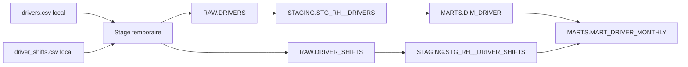

# Registre du traitement — données du personnel

## État et méthode

**Partie 1 complétée le 3 novembre 2026**, à partir du contrat intégral, de `exemples/FICHE_JURIDIQUE.md`, de la lecture locale des deux CSV et des SQL fournis. Les données sont fictives ; les exemples ci-dessous sont des formats ou valeurs de démonstration inventées, jamais une copie d’une ligne chauffeur. Les CSV restent locaux et ignorés par Git.

**Lignage prévisionnel**, issu de la lecture du code : les objets et volumes Snowflake ne sont pas encore vérifiés après chargement. Les copies effectives, retraits de colonnes, tags et preuves seront actualisés au fil du projet. La partie 2 reste à compléter au jour 3 ; ses champs vides ne sont pas des mesures appliquées.

## Partie 1 — Inventaire des données personnelles (jour 1)

Une donnée décrivant l’activité d’un chauffeur identifiable reste personnelle même sans nom. `driver_id` est un identifiant indirect/pseudonyme, pas une anonymisation. Fondement : [RGPD art. 4(1) et 4(5)](https://www.cnil.fr/fr/reglement-europeen-protection-donnees/chapitre1), consulté le 3 novembre 2026.

### Taxonomie et choix encore ouverts

Les tags de cette page sont **prévus**, pas encore posés. Les valeurs autorisées du contrat sont `nom`, `email`, `telephone`, `date_naissance`, `identifiant_officiel`, `identifiant_interne`. La mention **« à clarifier » n’est pas une valeur SQL** : le contrat ne prévoit aucune catégorie explicite pour les données professionnelles indirectes. Ne pas leur attribuer arbitrairement `identifiant_interne`, car cela pourrait les faire bénéficier de l’exception de visibilité prévue pour `driver_id`. Signaler ce manque au formateur et au référent gouvernance, tout en incluant ces données dans la conservation et l’analyse des accès.

### `drivers.csv` — 400 lignes, 10 colonnes

| Colonne | Exemple de format, non extrait | Nature dans ce contexte | Tag prévu | Usage et besoin à justifier |
|---|---|---|---|---|
| `driver_id` | `Dxxxx` | Identifiant indirect, clé de liaison | `identifiant_interne` | Tous rôles métier : compter et joindre ; pipeline : rattacher les services |
| `first_name` | prénom de démonstration | Identifiant direct avec le nom | `nom` | Paie : identifier ; responsable du dépôt : organiser le travail ; pipeline : construire `driver_name` |
| `last_name` | nom de démonstration | Identifiant direct avec le prénom | `nom` | Mêmes usages ; analyste sans accès en clair |
| `email` | `contact@domaine.example` | Identifiant direct | `email` | Paie : contact si nécessaire ; analyste et dépôt : aucun besoin établi |
| `phone` | numéro de démonstration | Identifiant direct | `telephone` | Paie et responsable du dépôt : contact opérationnel |
| `birth_date` | `AAAA-MM-JJ` | Identifiant indirect | `date_naissance` | Paie : justification RH à confirmer ; analyste : année seulement selon le contrat |
| `tlc_license_number` | format de licence TLC | Identifiant direct par rapprochement avec le registre public | `identifiant_officiel` | Paie/RH : identification professionnelle ; pipeline : contrôle d’unicité ; publicité de la licence ≠ libre accès dans l’entrepôt |
| `depot` | `Queens` | Donnée personnelle indirecte de rattachement dans cette table | À clarifier | Paie : affectation ; responsables : leur périmètre ; analyste : activité par dépôt ; filtre de lignes |
| `hire_date` | `AAAA-MM-JJ` | Donnée professionnelle indirecte | À clarifier | RH/paie : gestion du contrat ; pipeline : ancienneté et cohérence des dates ; nécessité pour les autres rôles à examiner |
| `end_date` | date ou champ vide | Donnée professionnelle indirecte | À clarifier | RH/paie : départ ; pipeline : statut et calcul de la purge ; vide = en poste |

### `driver_shifts.csv` — 25 951 lignes, 8 colonnes

| Colonne | Exemple de format, non extrait | Nature dans ce contexte | Tag prévu | Usage et besoin à justifier |
|---|---|---|---|---|
| `shift_id` | `Sxxxxxx` | Identifiant indirect d’un événement lié à une personne | `identifiant_interne` (aucune exception automatique de visibilité) | Pipeline : contrôle d’unicité et déduplication ; absent des MARTS fournis |
| `driver_id` | `Dxxxx` | Identifiant indirect du chauffeur | `identifiant_interne` | Pipeline : rattachement ; métier : compter/joindre sans nommer |
| `shift_date` | `AAAA-MM-JJ` | Activité professionnelle indirectement identifiante | À clarifier | Pipeline : mois d’activité ; paie et analyse : période de travail |
| `depot` | `Bronx` | Lieu de travail rattaché à une personne | À clarifier | Pipeline : regroupement ; responsables : périmètre ; analyse par dépôt |
| `start_hour` | heure entière | Horaire individuel, indirect | À clarifier | Organisation d’un service ; aucun usage dans les MARTS fournis, collecte à justifier |
| `hours_worked` | nombre décimal | Mesure individuelle de travail, indirecte | À clarifier | Paie, dépôt et analyste : volumes de travail, agrégés mensuellement |
| `trips_count` | entier | Mesure individuelle d’activité, indirecte | À clarifier | Dépôt et analyste : activité ; besoin paie à confirmer |
| `revenue_usd` | montant décimal | Mesure individuelle de recette, indirecte | À clarifier | Analyse et suivi métier ; besoin d’accès individuel à justifier |

Les heures, courses et recettes concernent un chauffeur dès lors qu’elles sont liées à `driver_id`. Les totaux mensuels par chauffeur restent personnels. Ces fichiers ne révèlent pas à première lecture de catégorie particulière de l’article 9 ; aucune telle donnée n’est nécessaire au brief.

### Colonnes techniques ajoutées au chargement

| Colonne RAW / STAGING | Nature | Usage et copies |
|---|---|---|
| `_source_file` / `source_file` | Métadonnée de fichier, pas un identifiant chauffeur par elle-même avec les noms génériques du kit ; fait partie de la ligne RH | Provenance et diagnostic du chargement ; RAW puis STAGING, pas MARTS |
| `_loaded_at` / `loaded_at` | Métadonnée de traitement, pas un identifiant chauffeur isolé ; trace associée à la ligne | Horodatage et déduplication ; RAW puis STAGING, pas MARTS |

Ne pas placer de nom de personne dans les noms de fichiers. Supprimer ces métadonnées avec la ligne chauffeur/service concernée. Les journaux techniques peuvent par ailleurs identifier les utilisateurs Snowflake ; ils ont une finalité et une durée à documenter séparément.

### Où cette donnée est-elle copiée ?

Tous les objets ci-dessous sont dans la base `NYC_TAXI`. Les vues STAGING ne constituent pas une copie matérialisée dans les scripts fournis. Les CSV locaux et le stage sont également dans le périmètre de conservation, même s’ils ne figurent pas dans le graphe SQL.

| Origine | RAW → STAGING | MARTS et transformation |
|---|---|---|
| `drivers.driver_id` | `RAW.DRIVERS.driver_id` → `STAGING.STG_RH__DRIVERS.driver_id` | `DIM_DRIVER.driver_id` ; jointure avec les services pour `MART_DRIVER_MONTHLY.driver_name` |
| `drivers.first_name`, `last_name` | Colonnes homonymes de RAW.DRIVERS puis STG_RH__DRIVERS | `DIM_DRIVER.first_name`, `last_name` ; concaténation prénom + espace + nom dans `MART_DRIVER_MONTHLY.driver_name` |
| `drivers.email` | `RAW.DRIVERS.email` → `STG_RH__DRIVERS.email` (espaces externes retirés, minuscules) | `DIM_DRIVER.email` |
| `drivers.phone` | `RAW.DRIVERS.phone` → `STG_RH__DRIVERS.phone` (espaces externes retirés, vide transformé en NULL) | `DIM_DRIVER.phone` |
| `drivers.birth_date` | Colonnes homonymes RAW et STAGING, date | `DIM_DRIVER.birth_date` ; année visible pour l’analyste à implémenter ultérieurement |
| `drivers.tlc_license_number` | Colonnes homonymes RAW et STAGING | `DIM_DRIVER.tlc_license_number` |
| `drivers.depot` | RAW puis STAGING (`INITCAP(TRIM(...))`) | `DIM_DRIVER.depot` ; le dépôt mensuel provient des services, pas de cette colonne |
| `drivers.hire_date` | Colonnes homonymes RAW et STAGING | `DIM_DRIVER.hire_date` et `tenure_years` (ancienneté calculée) |
| `drivers.end_date` | Colonnes homonymes RAW et STAGING | `DIM_DRIVER.end_date`, `is_active` (`end_date IS NULL`), `tenure_years` (date de fin ou date courante) |
| `driver_shifts.shift_id` | `RAW.DRIVER_SHIFTS.shift_id` → `STAGING.STG_RH__DRIVER_SHIFTS.shift_id` ; une ligne retenue par identifiant | Non conservé individuellement ; `nb_shifts` compte les services après déduplication |
| `driver_shifts.driver_id` | Colonnes homonymes RAW et STAGING | `MART_DRIVER_MONTHLY.driver_id` ; clé de jointure avec DIM_DRIVER |
| `driver_shifts.shift_date` | Colonnes homonymes RAW et STAGING | `MART_DRIVER_MONTHLY.activity_month`, premier jour du mois |
| `driver_shifts.depot` | RAW puis STAGING (`INITCAP(TRIM(...))`) | `MART_DRIVER_MONTHLY.depot`, regroupement par dépôt du service |
| `driver_shifts.start_hour` | Colonnes homonymes RAW et STAGING | Non repris dans les MARTS fournis |
| `driver_shifts.hours_worked` | Colonnes homonymes RAW et STAGING | `MART_DRIVER_MONTHLY.hours_worked`, somme mensuelle par chauffeur et dépôt, arrondie à une décimale |
| `driver_shifts.trips_count` | Colonnes homonymes RAW et STAGING | `MART_DRIVER_MONTHLY.trips_count`, somme mensuelle par chauffeur et dépôt |
| `driver_shifts.revenue_usd` | Colonnes homonymes RAW et STAGING | `MART_DRIVER_MONTHLY.revenue_usd`, somme mensuelle par chauffeur et dépôt, arrondie à deux décimales |
| Métadonnées des deux RAW | `_source_file` → `source_file`, `_loaded_at` → `loaded_at` dans la vue correspondante | Non reprises dans MARTS |

`MARTS.DIM_DEPOT` est un référentiel indépendant de trois garages (`depot`, `quartier`, `ouvert_en`, `nb_places`), sans chauffeur : aucune donnée personnelle dans ce référentiel. Le même nom de colonne `depot` est personnel dans une ligne chauffeur et non personnel dans ce référentiel.

Sources du lignage : `snowflake/rh/chargement_rh_1_preparer.sql`, `chargement_rh_2_copier.sql`, les deux fichiers `staging/`, `marts/dim_driver.sql`, `marts/mart_driver_monthly.sql` et `marts/dim_depot.sql`. Vérifier plus tard le Lineage Snowsight et les dépendances réellement déployées.

### Constats de lecture locale — pas des résultats Snowflake

Comptages réalisés le 3 novembre 2026 avec le lecteur CSV Python, sans écrire ni modifier les données sources :

| Mesure brute | Résultat |
|---|---:|
| Chauffeurs / colonnes du CSV | 400 / 10 |
| Services / colonnes du CSV | 25 951 / 8 |
| Chauffeurs en poste (`end_date` vide) | 290 |
| Actifs sans téléphone après retrait des espaces | 12 |
| Lignes moins licences distinctes (mesure du modèle fourni) | 4 |
| E-mails ne contenant pas `@` | 7 |
| Dépôts chauffeur différents exactement de Bronx/Brooklyn/Queens | 9 |
| Services dont le chauffeur est absent de drivers.csv | 25 |
| Lignes de service en surplus par identifiant | 18 |
| Services de plus de 16 heures | 14 |

Le seuil téléphone serait **14,5** pour 290 actifs : 12 manques ne dépassent pas 5 %, mais restent à traiter. Les 25 services orphelins ne dépassent pas le seuil bloquant de 50. Ces constats décrivent les fichiers avant purge ; les mesures de qualité sur RAW pourront changer après purge ou nouveau chargement. La mesure de licences compte les occurrences en surplus, pas le nombre de groupes de licences dupliquées.

### Ce qui a surpris et décisions à reprendre

- La licence est publique mais identifie toujours une personne ; elle ne doit pas être rendue visible à tous par défaut.
- `driver_name`, `is_active`, `tenure_years` et les agrégats mensuels restent personnels. Le nom peut fuiter dans la table mensuelle même si DIM_DRIVER est protégée.
- `start_hour` n’alimente aucun MART fourni ; sa nécessité doit être justifiée. Les données des anciens chauffeurs ne devraient pas rester accessibles au même titre que celles des actifs sans justification.
- Les services et leurs mesures doivent être couverts par la purge ; supprimer seulement le chauffeur laisserait des données d’activité identifiables et créerait des orphelins supplémentaires. Ne pas supprimer les orphelins préexistants pour masquer une anomalie.

---

## Partie 2 — Fiche de registre (jour 3)

Le registre des activités de traitement décrit ce qu'une organisation fait des données personnelles qu'elle détient. Cette fiche en est une version réduite, limitée à ce qu'un Data Engineer peut renseigner et prouver. La trame complète est celle de la CNIL (lien dans les ressources).

Chaque réponse de la colonne de droite doit pouvoir être vérifiée dans l'entrepôt : indiquez la requête ou le fichier qui le prouve.

### Le traitement

| Rubrique | Réponse |
|---|---|
| Nom du traitement | |
| Finalité : à quoi servent ces données | |
| Personnes concernées | |
| Service responsable des données | |

### Les données

| Catégorie de données | Colonnes concernées | Tables où elles se trouvent |
|---|---|---|
| Identité | | |
| Coordonnées | | |
| Vie professionnelle | | |

### Qui y accède

| Rôle | Ce qu'il voit | Pourquoi il en a besoin | Preuve (requête ou test) |
|---|---|---|---|
| | | | |

### Combien de temps

| Règle | Comment elle est appliquée | Preuve |
|---|---|---|
| R1 : suppression 5 ans après la fin du contrat | | |
| R2 : pas de restauration au-delà de 1 jour | | |
| R3 : pas de fichier sur le stage | | |

Délai réel entre l'exécution de la purge et la disparition définitive d'une donnée dans Snowflake, en tenant compte de Time Travel et de Fail-safe : ______ jours.

### Comment on le contrôle

| Question | Réponse | Preuve |
|---|---|---|
| Peut-on dire qui a lu ces données la semaine dernière ? | | |
| Sait-on quand une donnée est fausse ? | | |
| Que se passe-t-il si le rôle des outils est compromis ? | | |

### Limites connues

Ce que votre mise en œuvre ne couvre pas : deux ou trois lignes, sans détour.
